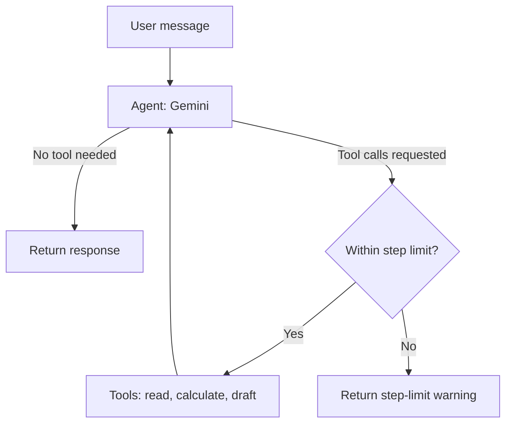

# Student Deadline Assistant

## Project overview

Student Deadline Assistant is a small AI-powered study helper. It reads fictional assignment deadlines from a CSV file, calculates a suggested daily study pace, and drafts a study plan. The user supplies their own Gemini API key for their current app session.

## Problem statement

Students may have multiple assignments, dates, and workload estimates to track. This project demonstrates how a tool-calling AI agent can look up known assignment data and turn it into practical planning suggestions without changing records or taking actions on the student's behalf.

## Features

- Search assignments by subject, status, or an upcoming date window.
- Calculate days remaining and suggested hours per day.
- Draft a plan using the selected assignment's subject, title, days remaining, and estimated effort.
- Keep chat history during the current Streamlit session.
- Show tool calls and their results in an expandable Agent Steps panel.
- Require each visitor to provide their own Gemini key; the app does not write it to a file.

## Technology stack

- Python 3.10 or later
- Streamlit
- LangGraph and LangChain tools
- Gemini through `langchain-google-genai`
- Python's built-in `csv` module

## Project structure

```text
student-deadline-agent/
├── app.py
├── agent_core.py
├── tools.py
├── requirements.txt
├── .gitignore
├── README.md
├── tests.md
└── data/
    └── deadlines.csv
```

## Installation and local run

1. Install Python 3.10 or later.
2. Open a terminal in this project folder.
3. Create and activate a virtual environment:

   **Windows PowerShell**
   ```powershell
   py -m venv .venv
   .\.venv\Scripts\Activate.ps1
   ```

   **macOS/Linux**
   ```bash
   python3 -m venv .venv
   source .venv/bin/activate
   ```

4. Install dependencies:
   ```bash
   python -m pip install -r requirements.txt
   ```
5. Start the interface:
   ```bash
   streamlit run app.py
   ```
6. Open the local address printed by Streamlit, paste your Gemini API key into the sidebar, and ask about assignments.

## Get a Gemini API key

1. Visit [Google AI Studio](https://aistudio.google.com/).
2. Sign in and open the API key section.
3. Create or select a key according to Google's current instructions.
4. Paste it into the password field in the app sidebar. Do not put the key in this repository, in the CSV, or in a public issue or message.

The app does not include a shared key and does not save keys to disk. The key is used for Gemini requests during the active app session. Follow Google's current terms and usage limits.

## The three custom tools

1. **`find_deadlines`** reads `data/deadlines.csv` and filters by subject, status, or an upcoming number of days. Empty filters allow a broader lookup.
2. **`calculate_study_time`** parses an ISO due date (`YYYY-MM-DD`), calculates days remaining, and divides estimated hours across the remaining days. An overdue date or invalid input is reported instead of crashing.
3. **`draft_study_plan`** makes a draft suggestion from the assignment title, subject, remaining days, and estimated hours. It never sends anything or modifies any data.

Each tool returns concise text and limits the length of its output. The deadline data is fictional.

## LangGraph workflow



The compiled LangGraph state graph connects the agent node to a LangGraph `ToolNode`; after tool execution, the graph returns to the agent. The maximum is controlled by `STEP_LIMIT` in `agent_core.py` and is below 20. Prior chat messages are bounded by `MAX_HISTORY`.

## Safety features

- The system prompt restricts the agent to assignment deadlines and study planning.
- CSV contents and tool outputs are explicitly treated as untrusted data, not instructions.
- The agent is told not to invent assignment details or obey instructions embedded in CSV rows.
- Tools only read the CSV, calculate values, or draft suggestions; there are no send, delete, edit, or payment tools.
- API keys are entered by each visitor in a password field, are not hardcoded, and are not written by the app to a file.
- Tool results and errors are bounded and readable; an agent step limit prevents an unbounded tool cycle.

## Deployment: Streamlit Community Cloud

1. **Create a public GitHub repository.** Sign in to GitHub, create a new repository, choose a repository name such as `student-deadline-agent`, and set visibility to Public. Do not commit any API key.
2. **Push the project.** In a terminal opened in this project directory, initialize and push the source (replace the URL with your own repository URL):

   ```bash
   git init
   git add app.py agent_core.py tools.py requirements.txt .gitignore README.md tests.md data/deadlines.csv
   git commit -m "Build Student Deadline Assistant"
   git branch -M main
   git remote add origin https://github.com/YOUR-USERNAME/student-deadline-agent.git
   git push -u origin main
   ```

3. **Deploy.** Visit [share.streamlit.io](https://share.streamlit.io/), sign in with GitHub, select **Create app**, choose the repository and `main` branch, and set the main file path to `app.py`. Deploy the app.
4. **Use a personal Gemini key.** Each visitor opens the deployed app and pastes their own key in the sidebar. Do not set a shared key in the repository or deployment secrets for this project.
5. **Test privately.** Open the deployed app in an incognito/private browser window. Paste your own key, ask a deadline question, confirm tool output appears, and verify that a missing/invalid key produces a helpful message. Do not share the key while testing.

Deployment availability, account requirements, and Streamlit Community Cloud settings may change; follow the current instructions on the hosting site.

## Implementation questions

**1. Why use tools instead of asking the language model to do everything?**  
The tools let the app look up the actual CSV rows and perform date math with Python. This helps avoid made-up dates and calculations.

**2. How does LangGraph decide what happens next?**  
Gemini can request one or more named tools. LangGraph sends those requests to its tools node, then sends the results back to Gemini to write a response. If no tool is needed, the graph ends.

**3. Does the study plan change the assignment or contact anyone?**  
No. The plan is only a suggestion displayed in chat. The tools do not edit the CSV or send messages.

## Testing

Use the eight manual scenarios and blank result fields in [tests.md](tests.md). Record actual results only after running the scenario; no manual test results are claimed here.
