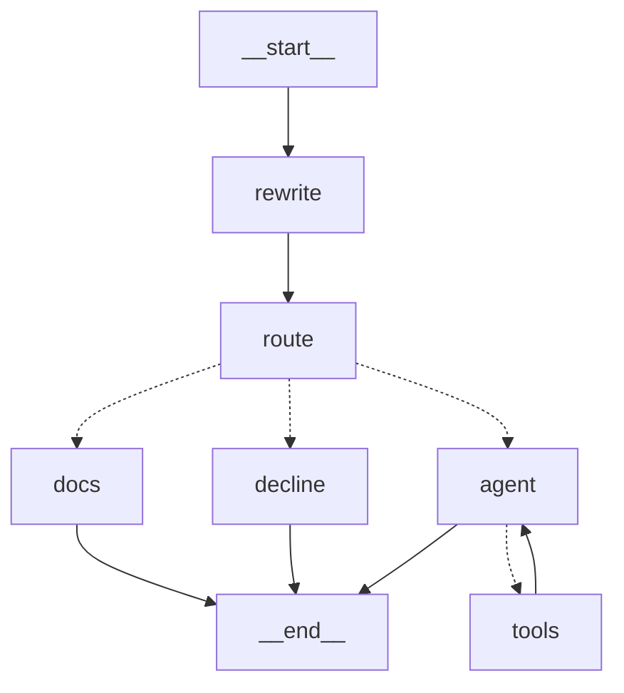

# Student Deadline Assistant

**Live app:** Not deployed yet — add your Streamlit Community Cloud URL after deployment.

Paste your own free-tier Gemini API key in the sidebar.

## User and job

This project is for students who want practical help with study techniques, assignment planning, and managing deadlines. It retrieves answers from its own study documents and uses small Python tools to calculate study time or draft a study plan.

## Documents

| File | Where it came from (written by me, or a link and licence) |
|---|---|
| study_techniques.txt | Original project documentation |
| assignment_planning.txt | Original project documentation |
| deadline_management.txt | Original project documentation |

The three original documents are about 4,400 words combined (roughly nine pages at 500 words per page), within the assignment's 5–30 page target. `data/deadlines.csv` is retained from the earlier project as optional supplementary data; this LU10 app does not use it as its knowledge source.

## How it works



The rewrite node turns a follow-up into a standalone question using the recent conversation, while leaving the first question unchanged. The router chooses `docs` for factual study guidance from the knowledge base, `tools` for a calculation or tailored study-plan draft, and `decline` for unrelated, unsafe, or secret-seeking requests. The docs node retrieves relevant passages, answers only from those passages, and cites their filenames and pages; if the information is missing, it uses the required fallback sentence. The tools route lets Gemini call the two Python tools through LangGraph's `ToolNode`, then returns the result to the agent; the decline route returns a fixed polite refusal.

## My tools

| Tool | Job (Read / Compute / Draft) | Example request |
|---|---|---|
| calculate_study_time | Compute | Calculate daily study time for 12 hours across 4 days |
| draft_study_plan | Draft | Create a study plan for my Python assignment |

## My extra feature

The Suggested Questions buttons provide four example study and assignment questions. Clicking a button submits that question through the same chat and graph workflow as typed text; the buttons do not display separate hardcoded answers.

## Run locally and deploy

Use Python 3.10 or later. In PowerShell, open this folder and run:

```powershell
py -m venv .venv
.\.venv\Scripts\Activate.ps1
python -m pip install -r requirements.txt
streamlit run app.py
```

Get a Gemini API key from [Google AI Studio](https://aistudio.google.com/) and paste it into the password field in the app sidebar. The app keeps the index in the current Streamlit session's memory; it does not write the key to a file. The Gemini chat model is selected by `GEMINI_CHAT_MODEL` in `graph_core.py`, and the embedding model is selected by `EMBEDDING_MODEL` in `rag_core.py`.

To deploy, create a public GitHub repository, push this project without an API key, then sign in at [Streamlit Community Cloud](https://share.streamlit.io/), create an app from the repository's `main` branch, and set the main file to `app.py`. Each visitor enters their own Gemini API key in the sidebar. After deployment, test in a private/incognito browser with your own key; do not share the key. Deployment has not been performed and no live URL is claimed.

After local tests, these are the Windows PowerShell commands to push the project (replace the username with yours; create an empty public GitHub repository first):

```powershell
git init
git add -A -- app.py agent_core.py tests.md graph_core.py rag_core.py tools.py requirements.txt .gitignore README.md eval.md plan.md knowledge_base data/deadlines.csv
git commit -m "Build LU10 Student Deadline Assistant"
git branch -M main
git remote add origin https://github.com/YOUR-USERNAME/student-deadline-assistant.git
git push -u origin main
```

If `origin` is already configured, update it with `git remote set-url origin https://github.com/YOUR-USERNAME/student-deadline-assistant.git` instead of adding it again. Review `git status` before committing and make sure no key or secret file is staged.

## Evaluation

Route accuracy: pending (0 of 12 evaluations recorded).
Answers passed: pending (0 of 12 evaluations recorded).

Before: the earlier implementation sent questions to a CSV-oriented, three-tool agent and did not retrieve study guidance from documents. Change: this version separates the rewrite/router/docs/tool/decline flow, adds document retrieval and citations, and limits the custom tool list to two. After: syntax, local graph behavior with mocked model responses, and document loading were checked; the 12 Gemini-backed evaluation results are still pending and must be recorded in [eval.md](eval.md).

## Limits

The app only knows what is written in the included documents and cannot verify school-specific rules, a student's official assignment deadlines, or personal circumstances. Gemini may route or summarize incorrectly, and embedding/chat requests need a valid visitor-provided API key, internet access, and available API quota. The study plan is a suggestion, not a calendar change or a guarantee of academic results. The vector index is in memory for the active session and is rebuilt for another session.

## My answers

**1. Why do my documents go through retrieval, and my calculations through tools?**

Retrieval finds the passages that are relevant to a question and gives the answer a source to cite. Python tools are better for calculations because they follow a clear formula and can check invalid numbers before returning a result.

**2. Why does the router use plain code to read the model's reply, and what happens if the reply is unclear?**

The router returns one short route label, and `parse_route()` checks that the label is exactly `docs`, `tools`, or `decline`. If the reply is missing or malformed, the code safely selects `docs` rather than sending the question to a tool or exposing anything.

**3. Walk through one real request from eval.md, node by node.**

The Gemini-backed evaluation has not been run yet, so I cannot report a real request or actual route. For test 7, the intended path is `rewrite → route → agent → tools → agent`; after running it, I will record the actual tool call and answer in `eval.md`.

**4. What would I change first if I had another week?**

I would run all 12 evaluation cases with my own key and tune the prompts or document chunks for any real failures. I would then add more original, carefully sourced student guidance only if the evaluation showed a knowledge gap.
